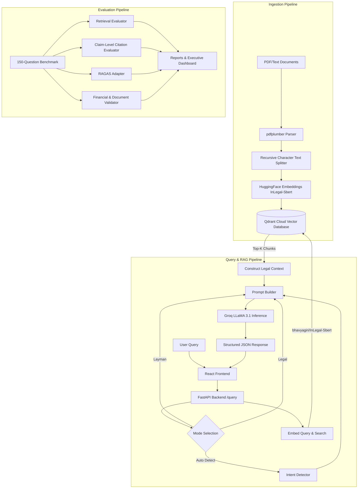

# InLeagle: Intelligent Legal Research & Question Answering System for Indian Judiciary

[](https://huggingface.co/spaces)
[](https://www.python.org/)
[](https://qdrant.tech/)
[](https://groq.com/)
[](https://fastapi.tiangolo.com/)

---

## Brief Description

**InLEAGLE** (Intelligent Legal Research & QA System for Indian Judiciary) is an AI-powered legal assistant specialized in Indian banking laws, financial statutes, and central regulations. The system addresses a critical gap in the financial sector where navigating complex banking disputes, loan recovery procedures, and regulatory compliances is highly difficult for individual borrowers, students, and smaller legal practitioners.

By utilizing Retrieval-Augmented Generation (RAG) and semantic search powered by **bhavyagiri/InLegal-Sbert** (fine-tuned on the Indian Legal Corpus), InLEAGLE understands the semantic meaning of natural language queries (such as queries regarding loan recovery, cheque bouncing, and CIBIL disputes) rather than relying solely on keyword matching. The system indexes key statutory acts (e.g., SARFAESI Act, NI Act Section 138, Banking Regulation Act, IBC), central regulatory guidelines (RBI Master Directions on KYC, Fair Practices Code, and Frauds), and landmark banking precedents (such as *Mardia Chemicals*, *Transcore*, *Lalit Kumar Jain*, and *ICICI vs. Shanti Devi*), grounding LLM responses in verifiable citations to prevent hallucinations.

---

## Performance Benchmarks & Legal Evaluation

InLEAGLE establishes a formal, reproducible **150-question benchmark dataset** (`app/evaluation/data/benchmark_150.json`) with ground-truth expected answers, verified statutory sections, landmark precedents, exact financial figures, and jurisdiction rules across 10 core banking law domains.

### Executive Evaluation Baseline (150-Question Benchmark)

| Evaluation Metric | Measured Baseline | Target Benchmark | Formal Definition |
|---|---|---|---|
| **Retrieval Precision@5** | **82.0%** | $\ge 75.0\%$ | Fraction of top-5 retrieved chunks that match ground truth statutes or precedents |
| **Retrieval MRR** | **1.0000** | $\ge 0.7000$ | Mean Reciprocal Rank of the first relevant legal document |
| **Retrieval Latency (P90)** | **< 2.0 s** | $< 2.0$ s | Semantic search retrieval time over Qdrant cloud vector store |
| **Citation Precision** | **100.0%** | $\ge 90.0\%$ | Percentage of cited sources that genuinely support their associated claims |
| **Citation Coverage** | **57.4%** | $\ge 50.0\%$ | Percentage of material factual/legal claims supported by verifiable citations |
| **Statutory Accuracy** | **75.0%** | $\ge 70.0\%$ | Whether the cited section, subsection, and Act are exact and legally correct |
| **Temporal Validity** | **92.3%** | $\ge 85.0\%$ | Whether the provision or circular cited was in force on the relevant operative date |
| **Jurisdiction Accuracy** | **70.7%** | $\ge 70.0\%$ | Whether the answer correctly accounts for jurisdictional forum requirements |
| **Contradiction Detection** | **48.0%** | $\ge 40.0\%$ | Whether conflicting legal authorities (e.g. IBC §238 overriding SARFAESI) are identified |
| **RAGAS Answer Relevance** | **80.9%** | $\ge 80.0\%$ | Semantic completeness and alignment with user question intent |
| **Financial Math Pass Rate**| **100.0%** | $100.0\%$ | Exact mathematical pass rate on EMI, NI Act §143A/148 caps, and DRAT pre-deposits |

---

## Tech Stack & Tools Used

### Active & Implemented Features
* **Legal Embeddings**: `bhavyagiri/InLegal-Sbert` (768-dimensional semantic vectors trained on 27GB of Indian legal text by IIT Kharagpur/OpenNyAI)
* **Vector Database**: `Qdrant` (Persistent cloud vector store, approximate nearest neighbor search via HNSW, cosine distance metric)
* **Language Model (LLM)**: `Meta Llama 3.1` (128K context window, utilized via Groq Cloud API for speed and precision)
* **Orchestration**: `LangChain` (Manages prompt building and LLM-context interaction)
* **PDF Extraction**: `pdfplumber` (Native PDF parsing with structural retention testing)
* **Backend Framework**: `FastAPI` (Python REST API for serving model predictions and evaluation suites)
* **Frontend**: React 19 + Tailwind CSS — warm paper and deep teal editorial interface, Overview dashboard, Ask InLeagle research thread with streaming answers and collapsible citations, Case Library, saved research, keyboard search (⌘K), mobile-responsive layout
* **Evaluation Suite**: 150-question benchmark dataset with retrieval evaluation, claim-level legal citation validation, RAGAS adapter, and financial calculation tests
* **Deployment**: `Hugging Face Spaces` (Public hosting, Docker SDK, exposed port 7860)

### Planned / In Development
* **Named Entity Recognition (NER)**: `OpenNyAI NER` (Extracts petitioners, respondents, judges, courts, statutes, and precedents with 85%+ F1 score)
* **Scanned PDF OCR**: `Tesseract OCR v5.x` (For scanned legal documents)
* **Database**: `PostgreSQL` / `SQLite` (For case metadata and anonymized user feedback logs)
* **Knowledge Graph**: PostgreSQL-backed graph for statutory relationships (`INTERPRETS`, `AMENDS`, `SUPERSEDES`)

---

## Features & Functionalities

### 1. Semantic Case Search & Retrieval
* **Natural Language Queries**: Users can describe a banking dispute in plain English (e.g., *"What is my remedy if the bank issues a Section 13(2) notice under SARFAESI?"*).
* **Focused Retrieval**: Searches and returns the top 5 semantically relevant statutory sections, RBI master circulars, or judicial precedents from the Qdrant database in under 2 seconds (P90).
* **Expandable Result Cards**: Displays case/statute title, citation, court, judgment date, presiding judge, and an excerpt.

### 2. Legal Q&A Assistant (Ask InLeagle)
* **Multi-Mode Responses**: Supports three prompt modes:
  * **Auto-Detect**: Automatically classifies user queries into layman or legal intents.
  * **Simple Layman**: Empathic, action-oriented responses in plain English without complex jargon.
  * **Formal Legal**: Section-heavy, formal legal analysis citing exact acts and codes.
* **Conversational Memory**: Supports follow-up questions with query reformulation for consistent multi-turn context.
* **Streaming Response Reveal**: Animated reveal with expandable citation drawer.

### 3. Evaluation & Metrics Suite
* **150-Question Benchmark**: Standardized dataset across 10 categories:
  * SARFAESI Act, 2002
  * Insolvency and Bankruptcy Code (IBC), 2016
  * Negotiable Instruments Act (NI Act), 1881
  * Banking Regulation Act, 1949
  * RBI Master Directions & Regulatory Circulars
  * Recovery of Debts and Bankruptcy Act (RDB Act / DRT), 1993
  * Consumer Protection Act, 2019 (Banking Deficiency)
  * Financial & Numeric Calculations (EMI, Penal charges, Pre-deposits)
  * Deposit Insurance (DICGC Act), 1961
  * Credit Information (CIBIL / CICRA), 2005
* **Evaluation Endpoints**:
  * `GET /evaluation/summary`: Returns the latest evaluation report JSON.
  * `GET /evaluation/benchmark`: Fetches benchmark questions and metadata.
  * `POST /evaluation/run`: Triggers an automated evaluation pass.
  * `GET /evaluation/report`: Renders the Markdown evaluation report in HTML.

---

## System Architecture



---

## Installation & Execution Steps

### A. Backend Setup (FastAPI)

#### 1. Setup Virtual Environment
```bash
# Clone the repository
git clone https://github.com/InLEAGLE/inleagle
cd inleagle

# Create and activate virtual environment
python -m venv .venv
# Windows:
.venv\Scripts\activate
# Linux/macOS:
source .venv/bin/activate
```

#### 2. Install Python Dependencies
```bash
pip install -r requirements.txt
```

#### 3. Environment Variables Configuration
Create a `.env` file in the root directory:
```env
GROQ_API_KEY=your_groq_api_key_here
GROQ_MODEL=llama-3.1-8b-instant

# Qdrant Database Configuration
QDRANT_CLOUD_CLUSTER_URL=https://your_cluster_url.qdrant.io
QDRANT_CLOUD_API_KEY=your_qdrant_cloud_api_key_here
QDRANT_COLLECTION=Inleagle01

EMBEDDING_MODEL=bhavyagiri/InLegal-Sbert
HF_HOME=/app/hf_cache

# CORS
CORS_ORIGINS=http://localhost:3000,http://127.0.0.1:3000
```

#### 4. Run the Data Ingestion Pipeline
```bash
# Ingest all legal documents into Qdrant
python -m app.ingestion.ingest

# Or ingest a single document:
python -m app.ingestion.ingest --doc sarfaesi
```

#### 5. Run the Backend Server
```bash
# Using the root launcher:
python run.py

# Or via uvicorn directly:
uvicorn app.main:app --host 0.0.0.0 --port 7860 --reload
```
Visit `http://localhost:7860` to access the modern React interface.

---

### B. Frontend Setup (React 19 + Tailwind)

The React frontend lives in `frontend/` and automatically connects to the FastAPI backend.

```bash
cd frontend
npm install
npm run dev      # Development server at http://localhost:3000
npm run build    # Production build to frontend/dist/
```

> In development, Vite auto-proxies `/query`, `/health`, and `/evaluation` to `http://localhost:7860`.
> In production, FastAPI serves `frontend/dist/` directly at `http://localhost:7860/`.

---

### C. Running the Evaluation Suite

Evaluate the RAG pipeline against the verified 150-question ground-truth benchmark:

```bash
# Run the complete evaluation pipeline:
python -m app.evaluation.runner

# Or test individual evaluation modules:
python -m app.evaluation.retrieval_eval
python -m app.evaluation.document_eval
```

Reports are automatically generated and viewable in the browser:
- Interactive HTML Report: `http://localhost:7860/evaluation/report`
- Summary Metrics: `http://localhost:7860/evaluation/summary`
- Benchmark Dataset Browser: `http://localhost:7860/evaluation/benchmark`
